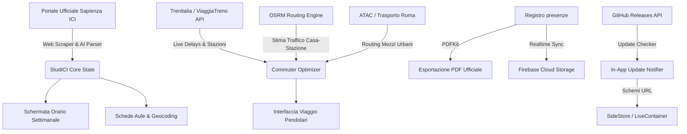

<p align="center">
  
</p>

<h1 align="center">StudICI</h1>

<p align="center">
  <b>App per gli studenti e pendolari di Ingegneria alla Sapienza Università di Roma.</b><br/>
  Orari delle lezioni, monitoraggio treni in tempo reale, tragitti urbani, registro presenze ed esportazione PDF.
</p>

<p align="center">
  <a href="https://github.com/Itachisann/StudICI/releases/latest">
    
  </a>
  
  
  
  
  
</p>

---

## 📖 Indice

1. [Funzionalità](#-funzionalità)
   - [📅 Orario delle Lezioni](#1-orario-delle-lezioni)
   - [🚆 Sezione Viaggio (Pendolari)](#2-sezione-viaggio-pendolari)
   - [🏛️ Aule e Sedi Sapienza](#3-aule-e-sedi-sapienza)
   - [📊 Registro presenze & Esportazione PDF](#4-registro-presenze--esportazione-pdf)
   - [☁️ Sincronizzazione tra Dispositivi](#5-sincronizzazione-tra-dispositivi)
   - [🔔 Aggiornamenti In-App](#6-aggiornamenti-in-app)
   - [🎨 Design & Temi](#7-design--temi)
2. [Installazione su iOS](#-installazione-su-ios)
   - [SideStore & AltStore](#opzione-1-sidestore--altstore-consigliata--aggiornamenti-automatici)
   - [LiveContainer](#opzione-2-livecontainer-nessun-limite-di-3-app)
   - [TrollStore](#opzione-3-trollstore-installazione-permanente)
   - [Sideloadly / AltServer](#opzione-4-sideloadly--altserver-via-computer)
3. [Architettura](#-architettura-tecnica--funzionamento)
4. [Sviluppo Locale](#-sviluppo-locale)
5. [Configurazione Cloud](#-configurazione-cloud-backend)
6. [Crediti & Disclaimer](#-crediti--disclaimer)

---

## ✨ Funzionalità

### 1. Orario delle Lezioni

- Orari ufficiali della Facoltà di Ingegneria Civile e Industriale (ICI) e dell'Informazione (I3S).
- Suddivisione per Corso di Laurea, anno e canale alfabetico (A-K, L-Z).
- Indicatore visivo delle lezioni in corso con tempo rimanente.
- Avvisi della presidenza (variazioni d'aula, lezioni sospese, festività).
- Cache locale offline per apertura istantanea.

### 2. Sezione Viaggio (Pendolari)

- **Treni in tempo reale**: collegamento con le API ViaggiaTreno per monitorare corse Regionali e Regionali Veloci.
- **Ritardi e binari**: orario programmato vs orario effettivo ricalcolato con il ritardo in tempo reale.
- **Tragitto in auto**: calcolo percorso casa-stazione con stima del traffico, festività, ponti e tempi di parcheggio.
- **Mezzi urbani**: indicazioni per raggiungere la sede della lezione dalla stazione di arrivo (Metro, Bus, Tram, a piedi).
- **Navigazione rapida**: apertura Google Maps per navigare dalla posizione GPS attuale o dalla stazione selezionata.
- **Selettore giorni**: visualizzazione orizzontale dal lunedì alla domenica per consultare orari lezioni e treni.

### 3. Aule e Sedi Sapienza

- Coordinate e indicazioni per tutte le sedi principali: San Pietro in Vincoli, Via Scarpa, Castro Laurenziano, Regina Elena e Città Universitaria.
- Navigazione in un tocco su Apple Maps o Google Maps.

### 4. Registro presenze & Esportazione PDF

- Registrazione rapida della frequenza tenendo premuta una lezione nell'orario.
- Riepilogo ore totali, lezioni frequentate e rispetto della soglia minima.
- Esportazione in PDF dell'orario settimanale e del registro presenze per la stampa o la condivisione.

### 5. Sincronizzazione tra Dispositivi

- Sincronizzazione tra più dispositivi iOS/iPadOS tramite codice univoco.
- Salvataggio e ripristino di corsi, canali, preferenze pendolari e presenze.
- Gestione dei dispositivi collegati con possibilità di disaccoppiamento in qualsiasi momento.

### 6. Aggiornamenti In-App

- Controllo automatico di nuove release pubblicate su GitHub.
- Notifica con aggiornamento diretto tramite SideStore, LiveContainer o download del file IPA.

### 7. Design & Temi

- Interfaccia in stile iOS con sfocature, menu contestuali e feedback aptico.
- Palette colori personalizzabili (_Sapienza Red_, _Midnight Blue_, _Emerald Green_, _Amethyst Purple_, _Slate Dark_, _AMOLED Black_).

---

## 📲 Guida all'Installazione & Sideloading (iOS)

A ogni aggiornamento su `main`, la pipeline di GitHub Actions compila automaticamente il file `.ipa` non firmato e lo pubblica nella sezione **[Releases](https://github.com/Itachisann/StudICI/releases/latest)**.

```
File IPA Ufficiale: StudICI.ipa
Download Diretto:   https://github.com/Itachisann/StudICI/releases/latest/download/StudICI.ipa
Sorgente SideStore: https://raw.githubusercontent.com/Itachisann/StudICI/main/apps.json
```

---

### Opzione 1: SideStore & AltStore (Consigliata · Aggiornamenti Automatici)

**[SideStore](https://sidestore.io)** permette di installare e aggiornare le app direttamente dal dispositivo iOS via Wi-Fi tramite VPN locale (WireGuard), senza dover ricollegare l'iPhone al computer ogni 7 giorni.

#### Aggiunta della Community Source (1-Tap):

1. Sul tuo iPhone, apri questo link per aggiungere automaticamente il repository a SideStore:
   ```
   sidestore://source?url=https%3A%2F%2Fraw.githubusercontent.com%2FItachisann%2FStudICI%2Fmain%2Fapps.json
   ```
2. Oppure manualmente:
   - Apri **SideStore** ➔ scheda **Sources** (in alto a destra premi **+**).
   - Incolla l'URL della sorgente:
     ```
     https://raw.githubusercontent.com/Itachisann/StudICI/main/apps.json
     ```
3. Cerca **StudICI** nella scheda _Browse_ e premi **GET** per installarla.
4. Da questo momento, quando esce una nuova versione, SideStore te la notificherà e potrai aggiornarla con un semplice tocco!

---

### Opzione 2: LiveContainer (Nessun limite di 3 app)

**[LiveContainer](https://github.com/khanhduytran0/LiveContainer)** permette di eseguire app non firmate senza consumare i 3 slot del certificato Apple ID gratuito e senza limiti di revoca.

#### Installazione Diretta con URL Scheme:

1. Apri questo link da Safari per avviare l'installazione automatica in LiveContainer:
   ```
   livecontainer://install?url=https%3A%2F%2Fgithub.com%2FItachisann%2FStudICI%2Freleases%2Flatest%2Fdownload%2FStudICI.ipa
   ```
2. Oppure manualmente:
   - Scarica il file `StudICI.ipa` da **[GitHub Releases](https://github.com/Itachisann/StudICI/releases/latest)**.
   - Apri **LiveContainer** ➔ premi l'icona **+** ➔ seleziona `StudICI.ipa`.

---

### Opzione 3: TrollStore (Installazione permanente)

Per dispositivi compatibili con **[TrollStore](https://github.com/opa334/TrollStore)** (iOS 14.0 – 16.6.1 / 17.0):

1. Scarica `StudICI.ipa` dall'ultima release.
2. Condividi il file e seleziona **"Apri con TrollStore"**.
3. L'app verrà installata permanentemente con certificato di sistema, senza scadenze dei 7 giorni e con supporto completo a tutte le funzioni native.

---

### Opzione 4: Sideloadly / AltServer via Computer

1. Scarica `StudICI.ipa` sul tuo PC/Mac da **[GitHub Releases](https://github.com/Itachisann/StudICI/releases/latest)**.
2. Collega l'iPhone con cavo USB.
3. Apri **[Sideloadly](https://sideloadly.io)** (o AltServer), trascina il file `StudICI.ipa`, inserisci il tuo Apple ID e premi **Start**.
4. Su iPhone, vai in _Impostazioni ➔ Generali ➔ VPN e gestione dispositivi_ e autorizza il tuo profilo sviluppatore.

---

## 🏛️ Architettura Tecnica & Funzionamento



- **Framework**: [Expo SDK 57](https://expo.dev) su React Native 0.76+ con architettura New Architecture (Bridgeless / Fabric).
- **Navigazione**: [Expo Router v4](https://docs.expo.dev/router/introduction/) (File-based routing typed con navigazione a schede native).
- **Backend Treni**: Parser asincrono REST basato su endpoint Trenitalia ViaggiaTreno con calcolo delta ritardi, gestione partenze programmate vs effettive e fallback multi-stazione.
- **Routing Stradale**: Engine Open Source Routing Machine (OSRM) per calcolo distanze chilometriche, tempi di percorrenza e correzione euristica per traffico di punta.
- **CI/CD Cloud**: Workflow GitHub Actions su macOS runner per la compilazione automatica e la pubblicazione delle release `latest`.

---

## 🛠️ Sviluppo Locale

### Requisiti

- **Node.js** 20+ o 22+
- **npm** o **bun**
- **Expo CLI** (`npx expo`)

```bash
# Clona il repository
git clone https://github.com/Itachisann/StudICI.git
cd StudICI

# Installa le dipendenze
npm install

# Avvia il server di sviluppo (Expo Go o Dev Client)
npx expo start

# Esegui typecheck rigoroso TypeScript
npx tsc --noEmit

# Esegui il linter
npx expo lint

# Diagnostica configurazione e dipendenze
npx expo-doctor
```

---

## ☁️ Configurazione Cloud Backend

La sincronizzazione tra dispositivi si basa su **Firebase Realtime Database** (piano Spark 100% gratuito). Ogni utente scrive e legge unicamente sul proprio percorso con codice crittografico univoco.

1. Vai su [Firebase Console](https://console.firebase.google.com) ➔ **Aggiungi progetto**.
2. **Build ➔ Realtime Database ➔ Crea database** (seleziona regione europea `europe-west1`).
3. Nella scheda **Regole**, incolla la policy di sicurezza:
   ```json
   {
     "rules": {
       "sync": {
         "$code": {
           ".read": true,
           ".write": true
         }
       }
     }
   }
   ```
4. Inserisci l'URL del tuo database in [`src/config/syncConfig.ts`](src/config/syncConfig.ts):
   ```ts
   export const SYNC_DB_URL =
     "https://tuo-database.europe-west1.firebasedatabase.app";
   ```

---

## 📜 Crediti & Disclaimer

- **Sviluppatore**: Vitor ([@Itachisann](https://github.com/Itachisann))
- **Progetto**: Open-source, indipendente e realizzato per la comunità studentesca.
- **Disclaimer**: _StudICI è un software non ufficiale e non è in alcun modo affiliato, sponsorizzato o approvato da Sapienza Università di Roma o da Trenitalia S.p.A. Tutti i marchi, i nomi di corsi e le stazioni appartengono ai rispettivi proprietari. I dati degli orari sono estratti dalle tabelle pubbliche fornite dalla presidenza di Facoltà._

---

<p align="center">
  Realizzato con ❤️ per tutti gli studenti e i pendolari della Sapienza.
</p>
